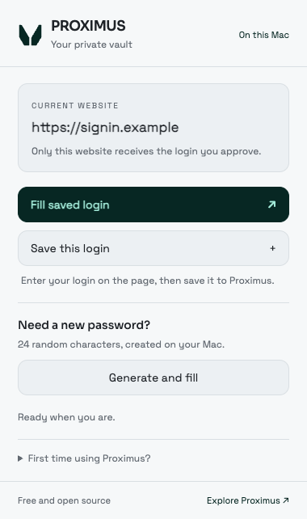

# Proximus for Chrome

Use your local Proximus vault to sign in on websites. Fill a saved login, save a new one, update an existing password, or generate a strong password without copying it to the clipboard.

Free and open source under [Apache-2.0](LICENSE). No Proximus account, subscription, or cloud connection is required.

<picture>
  <source media="(prefers-color-scheme: dark)" srcset="assets/preview-dark.png">
  
</picture>

## Installation

Requires Chrome 120 or later and the Proximus app on an Apple silicon Mac running macOS 14 or later. This extension is installed from the official source repository; there is no Chrome Web Store listing yet.

1. Get the source from [the official Proximus repository](https://github.com/orithellama/proximus_password_and_keygen_storage). Follow the [Mac installation guide](../README.md#installation-from-source) if you have not installed the app.
2. From the repository folder, run:

   ```sh
   ./install
   ```

   This updates the Mac app and connects it to Chrome. If the current app is already installed, only the connection step is needed:

   ```sh
   ./install --browser
   ```

3. Open `chrome://extensions` in Chrome.
4. Turn on **Developer mode**, choose **Load unpacked**, and select the **extension** folder in this repository.
5. Open Chrome's Extensions menu and pin **Proximus** to the toolbar.
6. Open the Mac app once to create or restore your vault if needed.

Keep the extension folder in place. Chrome loads it from that location. You do not need Node.js, npm, a browser account, or an Apple Developer account to load the extension. Building the Mac app from source requires the tools in the Mac installation guide.

If Proximus is installed somewhere else, specify its path:

```sh
./install --browser --app "/Applications/Proximus.app"
```

## Sign in

1. Open the website's sign-in page and check the address.
2. Click **Proximus** in Chrome's toolbar, then **Fill saved login**.
3. In the Proximus window, unlock your vault with Touch ID or your vault password.
4. Check the full website address and choose the account to use. Email addresses show only the first four characters.
5. Choose **Approve and fill login**. Confirm with Touch ID, your Mac login password, or **Confirm with vault password**.
6. Return to Chrome and press the website's sign-in button yourself.

Each browser request opens its own short-lived approval window. Unlocking the regular app does not leave browser access unlocked. Requests expire after two minutes. Changing tabs, navigating away, cancelling, closing the approval window, or locking the Mac cancels a pending request.

For websites that ask for a username before showing the password field, fill the username, continue on the website, and use **Fill saved login** again for the password step.

Only logins saved for the exact HTTPS origin are offered. For example, `https://example.com` and `https://accounts.example.com` are separate destinations. A different port is also a separate destination. Update a login's website in the app if the sign-in address has changed and you have verified the new address.

## Save or update a login

1. Enter your username and password on the website, before submitting the form.
2. Open Proximus in the toolbar and choose **Save this login**.
3. Unlock the approval window, check the website, and review the name and login details.
4. Choose **New login** or select an existing login for that website to update.
5. Choose **Save new login** or **Approve and update login**. Updating requires fresh authentication.

Proximus reads the fields only when you choose this action. It does not watch what you type or save passwords automatically. A confirmed save is not undone by subsequently closing the browser popup. If another app window has changed the vault, retry after reviewing the latest details.

## Generate a password

On a sign-up or password-change page, click the new-password field, open Proximus, and choose **Generate and fill**. Proximus creates a random 24-character password and fills the new-password and confirmation fields. Fields explicitly marked as the current password are left alone.

Choose **Save this login** before leaving the page. Generated passwords are not saved automatically, and navigating away can lose an unsaved password. Use a different generated password for every account.

## Privacy and permissions

The encrypted vault stays in the Mac app's existing storage. The extension does not keep a second vault, save credentials in browser storage, send analytics, load remote code, or contact a Proximus server. Optional app sync and iCloud backup remain controlled by your app settings.

| Permission | What it does |
| --- | --- |
| `activeTab` | Gives temporary access to the tab where you click Proximus. |
| `scripting` | Reads or fills the selected page's visible login fields after your action. |
| `nativeMessaging` | Opens the local Proximus approval window and receives the one login you approve. |

Chrome's [native messaging](https://developer.chrome.com/docs/extensions/develop/concepts/native-messaging) carries the request through local process pipes. Proximus does not open a local web server or place plaintext credentials in temporary files. The connection accepts the specific Proximus extension ID. It is not a cryptographic attestation of an unpacked extension: install and update only source you trust.

For filling, the app checks the saved website and requires fresh authentication. The extension checks the active tab, origin, original document, visible fields, and form destination again before inserting anything. It never automatically submits a form. Passwords briefly exist in app and browser memory while being used and become readable by the destination website when filled. A malicious website, browser, extension with access to that page, or compromised operating system can capture them. Proximus cannot guarantee a website's safety.

## Supported forms

Standard visible username, email, and password inputs in the main page are supported, including username-first sign-in and new-password confirmation fields. Proximus declines ambiguous forms, hidden fields, insecure HTTP pages, cross-origin form destinations, embedded frames, and private-browsing windows. Some sites use custom controls or shadow-root forms; use the app's authenticated copy controls for those sites after checking their address.

This extension fills passwords. It does not provide browser passkeys, crypto signing, or access to wallet keys. Safari, iPhone, and iPad use the app's separately provisioned Apple AutoFill integration; this Chrome extension is for Mac.

## Troubleshooting

**Could not connect:** Update the app with `./install`, then reload Proximus in `chrome://extensions`. If the app was moved, run `./install --browser --app "/new/path/Proximus.app"`. The browser connection points to that installed app.

**No matching login:** Check the complete sign-in address saved on the item. Subdomains and ports must match. Add the login with **Save this login** if it is not in your vault.

**No fields found or several forms found:** Open the actual sign-in form, click its email or password field, then open Proximus again. Embedded and custom forms may need authenticated copy and paste from the app.

**The request expired or the page changed:** Return to the sign-in tab and start again. Approval from an earlier page cannot be reused on the new page.

**Touch ID is unavailable:** Use the vault-password option. Supply your recovery key too if it is not saved on this Mac. A macOS Keychain dialog asks for your Mac login password, not your vault password.

**Chrome or another manager shows suggestions:** Proximus has its own toolbar button. Its local source installation does not add an entry to Google Password Manager's menu. You can turn off another manager's suggestions in its settings if they get in the way.

## Update or remove

After updating the source from the official repository, run `./install`, then click **Reload** on Proximus in `chrome://extensions`. Review source changes before installing an update. Unpacked extensions do not update themselves from a store.

To disconnect the browser:

```sh
./install --browser --uninstall
```

Remove Proximus from `chrome://extensions` to remove the extension. Your encrypted vault stays in the Mac app.

## License

[Apache License 2.0](LICENSE). Copyright 2026 PROXIMUS Research Labs Foundation. Proximus names and marks remain separate from the software license. Bundled Sora and Space Grotesk fonts use the SIL Open Font License included in `assets/`. [Project notice](../NOTICE)
